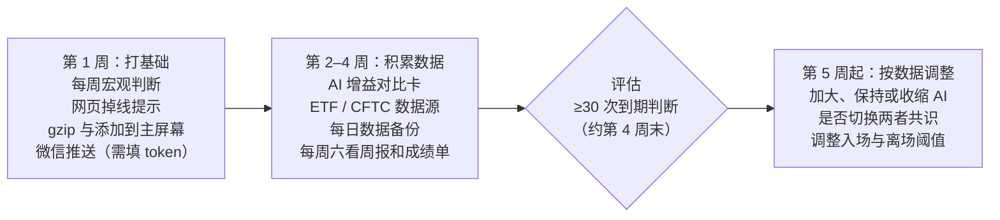

# 积存金监控：下一步方向

2026-10-15

> 本文保留当时的规划与观察，不代表当前运行状态。后续已改为 7 个独立策略账户、京东直接报价、规则快讯筛选、6 个前端标签页及分频缓存采集；当前行为以 README 和代码为准。

## 现状小结

监控、模拟盘、双 AI 分析和网页看板已于 10-15 全部上线并推送到 GitHub；下一步的重点不是加功能，而是**给中长线 AI 更好的输入，并用 2–4 周数据验证 AI 是否真的有用**。

| 模块 | 现状 | 关键数据 |
| --- | --- | --- |
| 实时监控 | 每分钟取价，银行报价每 20 分钟校准 | 浙商/民生溢价约 +1.5 元/克，正常 |
| 模拟盘 | 8 个账户：4 个纯规则、3 个 AI 主导、1 个基准 | 卖出手续费 0.4% 已计入 |
| AI 分析 | Claude + Codex 串行，输出涨跌概率 | 每次约 2 分钟；搜索 ≤2 次 |
| 触发机制 | 定时 08:40/20:45、数据公布后、30 分钟异动 ±0.6%、金十快讯（规则 + AI 初筛） | 快讯候选约 41 条/天，最多触发 4 次 |
| 成绩单 | 命中率、动量基准、两 AI 一致/分歧、Brier 分数 | 尚无到期样本 |
| 网页看板 | 5 个标签页，密码登录 | 端口 18080 |

回测（2011–2026）结论仍然成立：趋势择时回撤更小（23% vs 44%），但收益低于买入持有（1.84× vs 2.95×）。

## 方向一：每周宏观判断

每周一次、基于趋势数据的宏观判断，取代「AI 中长线」和「AI 定投」现在使用的每日新闻判断——3 个月的方向主要由实际利率、美元和资金流向决定，金十快讯只覆盖其中的「事件」。

| 数据 | 用途 | 来源 | 状态 |
| --- | --- | --- | --- |
| 10 年期实际利率（DFII10，10-13 为 2.88%） | 中长期金价最核心驱动 | 美联储 FRED | 可用，须直连（走代理超时） |
| 10 年期通胀预期（T10YIE，10-14 为 2.35%） | 通胀交易方向 | 美联储 FRED | 可用，须直连 |
| 美元指数、美债 2Y/10Y、离岸人民币 | 美元与汇率周度趋势 | TradingView / Yahoo | 已在用 |
| 联邦基金利率 | 当前利率水平 | TradingView | 可用 |
| CME 加息概率 | 市场定价的利率路径 | 金十快讯文字 | 可用（36 小时内 4 条） |
| 美联储讲话、数据实际值、地缘、央行动向 | 本周发生了什么 | 金十快讯 + 经济日历 | 已在用 |
| 国内金价溢价走势 | 国内买盘强弱 | 程序自己记录的银行报价 | 已有 |
| 黄金 ETF 持仓、CFTC 投机持仓 | 资金流向 | 金十为图片，读不了 | 待找数据源 |

实施步骤：

1. 程序整理上表各指标近 4 周与 12 周的变化，加上本周金十重要快讯和 CME 加息概率。
2. Claude 与 Codex 每周各分析一次（周日晚或周一开盘前，待定），输出宏观阶段（利率周期、实际利率趋势、美元与人民币方向、资金流向）和 3 个月涨跌概率。
3. 「AI 中长线」和「AI 定投」改用周度判断；每日判断只给短线用。
4. 网页 AI 页增加「本周宏观」卡片，周报附上周度结论。

额度成本：每个 AI 每周多 1 次分析，可忽略。

## 方向二：验证 AI 是否有用

暂不继续提高 AI 权重；观察 2–4 周成绩单后，按下表规则决定加大、保持还是收缩 AI 的作用。目前两个 AI 给出的概率都接近基准（3 日涨 41–43% / 跌 34%），瓶颈是 AI 的把握，而不是权重。

观察指标（每周六周报与网页成绩单）：

- 3 日命中率 vs 动量基准（同一批样本）
- Brier 分数 vs 基准分（3 日基准约 0.64，越低越准）
- 两个 AI 一致时的命中率，以及分歧时谁对得多
- AI 账户 vs 对应原版账户的收益差

| 成绩单表现 | 下一步 |
| --- | --- |
| 3 日命中率明显高于动量基准，且 Brier 明显低于基准 | 降低 AI 入场门槛，或让 AI 审核原版账户的交易 |
| 两个 AI 一致时明显更准 | 将 `GOLD_AI_STRATEGY_SOURCE` 切到 `consensus` |
| AI 账户收益明显好于原版 | 考虑让 AI 主导更多策略 |
| 与基准持平或更差 | 收缩 AI 作用，减少分析次数以节省额度 |

样本量要求：短期结论至少 30–40 次到期判断（约 3–4 周）；20/60 日周期的结论需要 2–3 个月。

## 方向三：其他待办

以下事项工作量都不大，其中「微信推送」只需填一个 token，对日常使用影响最大。

- [ ] **微信推送**：在 pushplus.plus 扫码拿 token 填入 `.env`，重启服务。目前所有提醒都是「仅记录」。
- [ ] **掉线提示**：行情超过 5 分钟未更新，网页顶部显示红色「数据已 X 分钟未更新」。
- [ ] **网页压缩与添加到主屏幕**：开启 gzip（接口 54 KB → 约 12 KB），加图标与应用名，手机上全屏打开。
- [ ] **AI 增益对比卡**：策略页并排三组「原版 vs AI」账户，直接显示 AI 版多赚或少赚多少。
- [ ] **ETF / CFTC 数据源**：尝试 SPDR 官网持仓文件与 CFTC 周报；不可用则由 AI 每周联网搜一次。
- [ ] **数据备份**：每天凌晨用 SQLite 在线备份复制到 `/root/gold-backups/`，保留 30 天；可选上传阿里云 OSS。模拟盘与成绩单记录无法重建。

## 优先级与时间安排

第 1 周先补输入与稳定性，第 2–4 周只积累数据、不改账户规则，第 4 周末达到约 30 次到期判断后再决定 AI 的作用。

## 风险与注意事项

最大的风险是样本太少就下结论，其次是订阅额度和非官方数据源的稳定性。

- **小样本**：前几周命中率波动很大，不作为调整依据；账户规则不要频繁改动，否则对比失效。
- **订阅额度**：Claude 与 Codex 均计入个人订阅，与日常使用共享；单次分析约 8–9 万输入 token。
- **金十接口**：为网页版公开接口而非官方 API，可能失效；失效时 AI 退回以联网搜索为主。
- **手续费**：卖出 0.4%（约 3.6 元/克）使日内短线机会很少，短线账户长期零交易属正常。
- **服务器资源**：2 核 1.6 GB，AI 已改为串行并与银行浏览器互斥；仍不要增加常驻浏览器任务。
- **公开仓库**：代码与策略规则公开，密码、数据库、服务器地址均未提交，提交前继续做敏感信息检查。
- **模拟不等于实盘**：不含滑点与银行交易时段限制，结论仅供参考，不构成投资建议。
